# Still My Voice architecture

```mermaid
flowchart LR
  Pico[Approved Pico v2 firmware] --> CDC[Dedicated CDC2 data port]
  CDC --> Adapter[Accepted serial adapter and freshness validation]
  Adapter --> Kernel[Accepted DOWN / UP kernel]
  Kernel --> Navigation[App navigation coordinator]
  Navigation --> Compose[Communication model and revisioned view]
  Compose --> Review[Exact complete review]
  Review --> Approval[Fresh separate Speak selection]
  Approval --> Snapshot[Immutable one-use authorization]
  Snapshot --> Speech[Speech controller]
  Speech --> Local[Browser speech]
  Speech -. pending integration .-> Premium[Local API to ElevenLabs]
  AI[Isolated Gemini proposal boundary] -. explicit selection only; UI pending .-> Compose
```

The accepted reducer, freshness arithmetic and wire format remain unchanged. Host protocol/adapter edits add bounded diagnostics and distinct fatal reasons only. They own framing, protocol/epoch/sequence validation, clock-wrap-aware freshness, heartbeat evidence, captured targets and matched releases. A heartbeat cannot select, release, authorize speech or move the captured target.

The app coordinator owns context replacement. A selected action produces a new view revision; the old port session is stopped and fully closed before the same verified port is reopened. A shared cleanup barrier covers multiple rapid updates and in-flight opening, followed by a 200 ms disconnected settling interval before reopening. Each connection creates a fresh unpredictable instance and requests actual current button state. A pressed snapshot requires a release-only synchronization followed by a fresh cycle. Genuine interruption stops the connection and requires explicit recovery.

The communication model contains only in-memory draft, revision, bounded Undo, navigation, settings, review presentation and current authorization. The model validates the selected visible target against the current view revision. Composition, word repair, suggestion selection and Review are never speech approval.

The speech controller consumes an immutable authorization once. The browser engine cannot replace its exact text or silently substitute a missing voice. Input loss, focus/visibility change, Stop, edit and failure cancel active/pending work. Completion/error callbacks carry the authorization identity and cannot modify a newer operation. During hardware speech preparation, the stationary Stop view must be freshly synchronized and released before audio starts.

Review pagination measures real layout and preserves all whitespace and characters. A page is credited only after it is fully visible. Repagination resets presentation; every part must be presented before Speak is available. This proves neither attention nor comprehension. Changing the enabled target set creates another input view revision.

Cloud boundaries are isolated and currently **not wired into the UI**. The local API holds provider keys, validates bounded JSON, restricts Host/Origin, aborts on disconnection/timeouts and sanitizes errors. No draft, transcript, provider response or credentials are logged. The only browser-facing cloud data will be suggestions, voice metadata and authorized audio, never keys. Gemini is proposal-only with explicit fictional-data and no-billing gates; ElevenLabs is exact-text-only with explicit credit confirmation. Neither can import the input coordinator or create speech authorization.

No persistence, analytics, microphone, gaze, authentication or deployment is implemented at this checkpoint. Reload discards drafts and all authorization/input history. Production exposure requires a separate security and deployment review.
